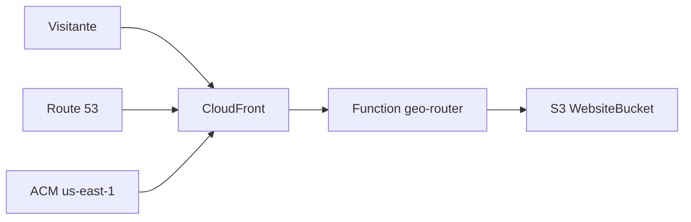

# Cloudfianz — Infraestructura AWS

Referencia operativa para quien mantiene el sitio y el CDK. Dominio: **cloudfianz.com**.

> Nota: existe documentación más antigua en `Plan/cloudfianz-infra.md`; **este archivo es la fuente actual** (scripts `.mjs`, stacks y exports reales).

---

## Resumen

| Componente | Descripción |
|------------|-------------|
| **Hosting** | S3 (privado) + CloudFront (OAC) |
| **DNS** | Route 53 hosted zone `cloudfianz.com` |
| **TLS** | ACM en **us-east-1** (requerido por CloudFront) |
| **Entornos** | `prod` → `cloudfianz.com`, `www.cloudfianz.com` · `staging` → `staging.cloudfianz.com` |
| **IaC** | AWS CDK v2 (TypeScript) en `infra/` |
| **Cuenta** | Infra desplegada en AWS account **118774113949** (validar con `aws sts get-caller-identity`) |

Región principal de stacks de sitio/DNS: la de `CDK_DEFAULT_REGION` (típicamente **us-east-1**). El certificado siempre en **us-east-1**.

---

## Stacks CDK (orden de dependencia)

Definidos en `infra/bin/app.ts`:

| Stack | Propósito |
|-------|-----------|
| **DnsStack** | Hosted zone pública; output nameservers para el registrador |
| **CertificateStack** | Certificado ACM `cloudfianz.com` + SANs (`www`, staging) |
| **WebsiteStack-prod** | Bucket S3 + distribución CloudFront producción |
| **WebsiteStack-staging** | Igual para staging |
| **DnsRecordsStack** | Alias A/AAAA hacia CloudFront |

Contexto `stagingOnly` en `infra/cdk.json`: si es `"true"`, no se crea el stack prod (por defecto del proyecto: `"false"` → prod incluido).

---

## Recursos por entorno (website)

Por cada `WebsiteStack-{prod|staging}` (`infra/lib/website-stack.ts`):

- **S3:** `cloudfianz-{prod|staging}-{ACCOUNT_ID}`, sin acceso público, cifrado SSE-S3.
- **CloudFront:** HTTPS, compresión, políticas de caché (HTML TTL 0; `assets/*` TTL largo).
- **CloudFront Function:** `cloudfianz-geo-router-{env}` — código en `infra/functions/geo-router.js`.
- **Headers:** HSTS, `X-Frame-Options`, `X-Robots-Tag` (prod indexable; staging `noindex`).
- **SPA-ish:** 403/404 → `index.html` (rutas `/es` resueltas en la function).

**Geo / idioma (function):**

- `/es` sirve `index.html` manteniendo la URL.
- Home `/`: cookie `cf_lang` o geo LATAM → redirect 302 a `/es`.
- Resto: inglés en `/`.

---

## Exports de CloudFormation (deploy de contenido)

El script `scripts/deploy.mjs` lee estos exports (no hardcodea bucket ni distribution ID):

| Export | Uso |
|--------|-----|
| `CloudfianzBucket-prod` / `CloudfianzBucket-staging` | Destino `aws s3 sync` |
| `CloudfianzDistributionId-prod` / `...-staging` | Invalidación `/*` |
| `CloudfianzDomain-{env}` | Dominio CF (referencia) |
| `CloudfianzHostedZoneId` | DNS (CDK) |

Si `deploy.mjs` falla con “No se encontraron exports”, estás en la **cuenta AWS incorrecta** o la infra nunca se desplegó ahí.

---

## Flujo de deploy de contenido

1. `npm run build` — casos + copia ES.
2. Sync `src/` al bucket (HTML sin cache largo; `assets/` con `max-age` 30 días).
3. `create-invalidation` CloudFront en `/*`.

Comandos raíz: `npm run deploy:staging` | `npm run deploy:prod`.

---

## Flujo de deploy de infra

```powershell
cd infra
npm install
aws sts get-caller-identity    # cuenta correcta
npx cdk bootstrap aws://118774113949/us-east-1   # solo primera vez por cuenta/región
npm run deploy:all
```

Despliegue parcial (scripts en `infra/package.json`): `deploy:dns`, `deploy:cert`, `deploy:staging`, `deploy:prod`, `deploy:records`.

Tras **DnsStack**: copiar **nameservers** del output al registrador del dominio.

---

## Permisos IAM mínimos (humano o CI)

Para **solo publicar contenido:**

- `s3:ListBucket`, `s3:GetObject`, `s3:PutObject`, `s3:DeleteObject` en los buckets `cloudfianz-*`.
- `cloudfront:CreateInvalidation` en las distribuciones de Cloudfianz.

Para **CDK deploy:**

- CloudFormation full stack + roles de bootstrap CDK + Route53, ACM, S3, CloudFront según stacks.

Recomendado: usuario/rol dedicado “Cloudfianz deploy”, no credenciales personales compartidas.

---

## Diagrama lógico



---

## Checklist handoff

- [ ] Compañero con acceso al repo Git y a cuenta **118774113949** (o la cuenta vigente si migraron).
- [ ] `aws configure` o SSO con perfil documentado (ej. `AWS_PROFILE=cloudfianz`).
- [ ] `npm install` + `npm run dev` funciona en su máquina.
- [ ] `npm run deploy:staging` exitoso antes de tocar prod.
- [ ] Videos `intro.mp4` / `intro_en.mp4` en `src/assets/videos/` o acordado cómo compartirlos.
- [ ] Registrador apunta a nameservers de Route 53 (si se recrea DnsStack).

---

## Qué no va en Git

- `node_modules/`, `infra/cdk.out/`
- Claves AWS, `.env`
- Videos grandes (opcional en `.gitignore`; usar LFS o Drive/S3 aparte)

---

## Contacto / integraciones externas

- **Formulario HubSpot:** embebido en `src/index.html` (portalId `599312`).
- **SEO:** `src/sitemap.xml`, `src/robots.txt`, JSON-LD en `index.html`.
